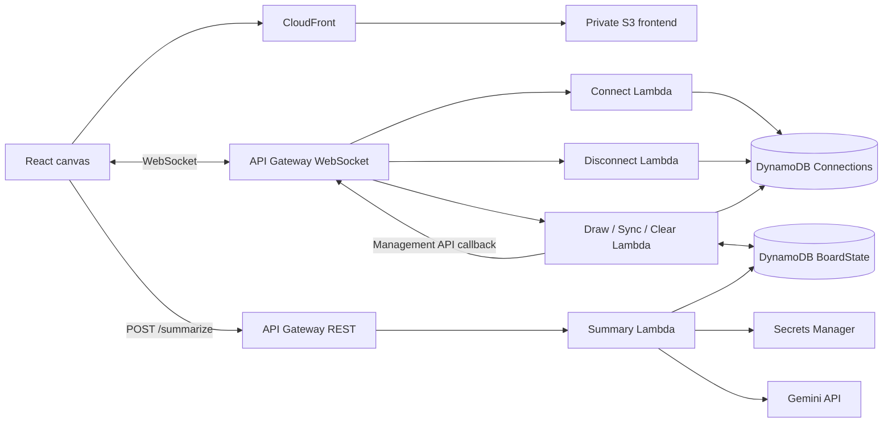

# Commonboard — Serverless Real-Time Collaborative Whiteboard

A complete React + Vite application with AWS Lambda handlers and a SAM/CloudFormation deployment. Built against the supplied project-details PDF, including its architecture diagram. The PDF's submission contact details are intentionally not copied into this public-ready repository.

## Architecture



The production application uses real AWS SDK requests. There is no mock service, local emulator, fake collaboration, or hardcoded AI response in the application. Unit tests inject isolated test doubles; they do not prove cloud deployment.

## Features

- Shared rooms with random default IDs and copyable invitation URLs.
- Pen, eraser, six ink colors, stroke width, and typed notes on a responsive 1440 × 900 logical canvas.
- Drawing segments sent while drawing (up to every 180 ms on pointer movement), not only on pointer release.
- DynamoDB persistence, concurrent-write protection, idempotent stroke retries, safe clear/reset epochs.
- Automatic reconnect with backoff, initial state restoration, connection status, unsaved-operation indicators, and periodic reconciliation.
- Summaries of saved sketches and typed notes using a server-side Gemini request and a Secrets Manager credential.
- Private encrypted S3 origin, CloudFront HTTPS delivery, scoped IAM, API throttles, input validation, and stale connection cleanup.

## Project structure

```text
frontend/
  src/App.jsx                 UI and pointer interactions
  src/useBoard.js             WebSocket lifecycle and pending operations
  src/protocol.js             Interleaved snapshot assembly
  src/canvas.js               Canvas rendering
  src/styles.css              Responsive styling
  .env.example
backend/
  src/domain.js               Validation, board operations, snapshot framing
  src/store.js                DynamoDB access and conditional writes
  src/socket.js               Connect/disconnect/draw/sync/clear handlers
  src/summary.js              REST summary handler and Secrets Manager access
  src/raster.js               Portable PNG rendering for Gemini
  test/                       Backend and protocol unit tests
scripts/
  build-backend.mjs           Bundle Node.js Lambda artifacts
  create-secret.py            Hidden-input secret creation/rotation
  configure-frontend.mjs      Generate frontend env from stack outputs
  deploy.sh                   Validate, deploy, configure, upload, invalidate
  smoke.mjs                   Live AWS two-client integration check
tests/infrastructure.test.js Static contract checks
docs/TESTING.md              Manual end-to-end checks and demo
docs/VERIFICATION.md         Verification record and limitations
template.yaml               AWS SAM/CloudFormation infrastructure
package.json / package-lock.json
```

## Prerequisites

Local UI and unit tests: Node.js 22 or newer and npm. Deployment additionally needs AWS CLI v2, AWS SAM CLI with its lint dependencies, Python 3, an AWS account/profile allowed to create this stack, and a Gemini API key with an available image-capable model supporting `generateContent`.

Install AWS CLI and SAM using their official installers: [AWS CLI](https://docs.aws.amazon.com/cli/latest/userguide/getting-started-install.html), [SAM CLI](https://docs.aws.amazon.com/serverless-application-model/latest/developerguide/install-sam-cli.html). Configure a profile with `aws configure sso` / `aws sso login`, or your normal AWS credential workflow. Never put AWS credentials in frontend environment variables.

## Local setup

```bash
npm ci
cp frontend/.env.example frontend/.env.local
# Edit frontend/.env.local with your deployed API endpoints.
npm run dev
```

Open `http://localhost:5173`. With no real endpoints configured, the interface displays **Setup required** and disables cloud-dependent actions. Deploy the backend first to test real collaboration locally; the template permits localhost:5173 and 127.0.0.1:5173 for REST requests. There is no separate always-on application server.

```bash
npm test       # no AWS credentials required; unit/contract tests only
npm run build # production frontend + portable Lambda bundles
npm run check # tests and builds
```

The build output is `frontend/dist/` and `.aws-sam/build/handlers/{socket,summary}.cjs`. These directories are ignored. SAM packages the prebuilt bundles directly; **do not run `sam build`**, which uses the same `.aws-sam/build` output directory and can overwrite them. `npm run build` is the build command for this project.

## Environment variables and secrets

| Name | Location | Purpose |
| --- | --- | --- |
| `VITE_WEBSOCKET_URL` | `frontend/.env.local` | Public `wss://…/prod` WebSocket URL |
| `VITE_API_URL` | `frontend/.env.local` | Public REST base URL `https://…/prod`, without `/summarize` |
| `AWS_REGION` | Deployment shell | AWS region, e.g. `ap-south-1` |
| `AWS_PROFILE` | Deployment shell, optional | Your configured AWS profile |
| `STACK_NAME` | Deployment shell, optional | Default `commonboard` |
| `GEMINI_SECRET_ARN` | Deployment shell; mapped to Lambda | Existing secret ARN, never the key itself |
| `GEMINI_MODEL` | Deployment shell; mapped to Lambda | Available image-capable model ID; deliberately required because availability changes |
| `LOCAL_ORIGIN` | Deployment shell, optional | Additional local frontend origin; default `http://localhost:5173` |
| `BOARDS_TABLE`, `CONNECTIONS_TABLE` | Lambda, set by template | Generated DynamoDB table names |
| `ALLOWED_ORIGINS` | Summary Lambda, set by template | Exact CloudFront and development origins |

The Secrets Manager value must be JSON: `{"apiKey":"YOUR_REAL_GEMINI_KEY"}`. Use the helper below; it reads the key without echo and sends it to the AWS CLI over stdin. It supports creating or rotating the same named secret. The secret should be in the deployment region and use the default Secrets Manager encryption key. A customer-managed KMS key needs an additional scoped `kms:Decrypt` permission in the summary function policy.

## AWS deployment

These commands create billable resources in your selected AWS account.

```bash
export AWS_PROFILE=your-profile
export AWS_REGION=ap-south-1
aws sts get-caller-identity
python3 scripts/create-secret.py commonboard/gemini
# Copy the returned ARN, not the key:
export GEMINI_SECRET_ARN='arn:aws:secretsmanager:ap-south-1:ACCOUNT:secret:commonboard/gemini-SUFFIX'
export GEMINI_MODEL='YOUR_AVAILABLE_IMAGE_CAPABLE_MODEL_ID'
export STACK_NAME=commonboard
npm run deploy
```

The deployment script runs dependency installation, tests, production builds and `sam validate --lint`; deploys with `sam deploy --resolve-s3`; writes public endpoints to `frontend/.env.local`; rebuilds React; uploads hashed assets and `index.html`; and requests a CloudFront invalidation. A successful command prints the website URL. Allow the invalidation to finish before testing an update. Re-run `npm run dev` after endpoint configuration changes.

The template provisions:

1. A pay-per-request BoardState table with encryption, point-in-time recovery, and retention on stack deletion.
2. A pay-per-request Connections table with a `byBoard` index and TTL.
3. Connect, Disconnect, Draw, and Summary Node.js 22 Lambda functions, each with an execution role and scoped data permissions; Lambda creates CloudWatch log groups on first invocation.
4. API Gateway WebSocket API with `$connect`, `$disconnect`, `draw`, `sync`, `clear`, and `$default` routes and an auto-deploying `prod` stage.
5. API Gateway **REST API**, `POST /summarize`, preflight support and a `prod` stage.
6. Private encrypted S3 hosting, CloudFront distribution and origin access control, and a distribution-scoped bucket policy.
7. Lambda invocation permissions. SAM also manages an artifact bucket used to upload Lambda packages.

Secrets Manager is provisioned separately by `create-secret.py` so the secret value never enters CloudFormation parameters or the repo. The summary Lambda receives permission for only that ARN. No Gemini credential is present in the browser bundle.

### Manual equivalent / CI deployment

```bash
npm ci
npm run check
sam validate --lint --template-file template.yaml --region "$AWS_REGION"
sam deploy --template-file template.yaml --stack-name "$STACK_NAME" \
  --region "$AWS_REGION" --resolve-s3 --capabilities CAPABILITY_IAM \
  --parameter-overrides "GeminiSecretArn=$GEMINI_SECRET_ARN" "GeminiModel=$GEMINI_MODEL"
mkdir -p artifacts
aws cloudformation describe-stacks --stack-name "$STACK_NAME" \
  --region "$AWS_REGION" --query 'Stacks[0].Outputs' --output json > artifacts/stack-outputs.json
node scripts/configure-frontend.mjs artifacts/stack-outputs.json
npm run build -w frontend
# Set these to the stack's FrontendBucketName and DistributionId outputs:
aws s3 sync frontend/dist/ "s3://$FRONTEND_BUCKET/" --exclude index.html \
  --cache-control 'public,max-age=31536000,immutable'
aws s3 cp frontend/dist/index.html "s3://$FRONTEND_BUCKET/index.html" \
  --cache-control 'no-cache,max-age=0,must-revalidate' --content-type text/html
aws cloudfront create-invalidation --distribution-id "$DISTRIBUTION_ID" --paths '/*'
```

No custom domain, certificate provisioning, VPC, API keys in React, or long-running server is needed. The default CloudFront hostname is HTTPS. The app uses a query-string room URL, so no SPA path fallback is required.

## DynamoDB schema and consistency

Physical names are generated by CloudFormation and returned as `BoardsTableName` and `ConnectionsTableName`.

| Table/index | Partition key | Sort key | Important attributes and access |
| --- | --- | --- | --- |
| BoardState | `boardId` (string) | None | `revision`, `epoch`, `elements`, `updatedAt`, optional `lastClearId`, `summaryAfter`. Strongly consistent GetItem by room; conditional PutItem for edits. |
| Connections | `connectionId` (string) | None | `boardId`, Unix-seconds `expiresAt`. Put on connect, Get on each action, Delete on disconnect/410. |
| Connections / `byBoard` GSI | `boardId` (string) | None | ALL projection; paginated Query for recipients, TTL-expired items filtered in code. |

A room is created on its first successful connection. Each board is a single bounded item: at most 1,500 elements and 220,000 JSON bytes. This keeps the implementation understandable and comfortably below DynamoDB's item limit, including attribute overhead. Each freehand segment or typed note is one element. When full, the UI tells users to create another board or clear the current one.

Edits read the latest board, apply an operation, and write only if `revision` has not changed. Conflicts re-read and retry up to ten times. Unique element IDs deduplicate retransmitted strokes. Clear changes the board's `epoch`, so delayed strokes cannot restore erased content. A retried clear is recognized by its last request ID. The summary cooldown also increments revision so a simultaneous edit cannot overwrite the cooldown.

Snapshot broadcasts carry the complete bounded board, fragmented into JSON messages under 32 KB. Clients assemble interleaved snapshots by ID and ignore older revisions. This favors simple, correct convergence over bandwidth efficiency. Eight recipient deliveries run at a time. Every 15 seconds clients sync and resend unacknowledged operations; a failed broadcast is repaired by sync. A 45-second response watchdog forces reconnect. The connection table's GSI is eventually consistent, so the sender is explicitly included even if the GSI has not caught up.

## WebSocket contract

Connect to `wss://…/prod?boardId=ROOM_ID`. Room IDs contain 6–64 ASCII letters, numbers, `_` or `-` (case-sensitive). The server takes the room from the stored connection, never a client-supplied room on an edit.

After the WebSocket opens, send:

```json
{"action":"sync"}
```

The server responds with one or more frames:

```json
{"type":"snapshot","snapshotId":"uuid","index":0,"count":1,"data":"JSON fragment"}
```

Concatenating `data` by `index` produces `{boardId,revision,epoch,elements,updatedAt,...}`. Use the current `epoch` in every mutation:

```json
{"action":"draw","requestId":"unique-stroke-id","epoch":"CURRENT_EPOCH","element":{"id":"unique-stroke-id","tool":"pen","color":"#183349","width":4,"points":[[20,30],[25,35]]}}
```

`requestId` must equal the element ID; both are 10–64 letters, numbers, `_` or `-`. `tool` is `pen`, `eraser`, or `text`. Strokes contain 1–80 points within 1440 × 900; width is 1–60. Text elements replace `points` with `text` (1–200 characters), `x`, and `y`; width is font size.

```json
{"action":"clear","requestId":"unique-clear-id","epoch":"CURRENT_EPOCH"}
```

Successful mutations broadcast snapshots and return `{"type":"ack","requestId":"…","revision":1}`. Errors return `{"type":"error","requestId":"…","message":"…"}`; clients then sync. Messages are limited to 16 KB. `$default` rejects unknown actions. Connections expire after 7,500 seconds in the table; API Gateway's connection lifetime forces clients to reconnect earlier. TTL cleanup is asynchronous, so expired rows are filtered immediately in code and stale callback destinations are removed on HTTP 410.

## REST / AI contract

`POST {VITE_API_URL}/summarize` with JSON `{"boardId":"ROOM_ID"}`. Returns `{"boardId":"ROOM_ID","revision":N,"summary":"…"}`. Errors return JSON `{"error":"…"}` and appropriate 400/403/404/413/429/500/502 status codes.

The Lambda retrieves the persisted board, enforces a 15-second per-board cooldown, loads the Gemini credential from Secrets Manager (cached for five minutes), renders sketch strokes to a PNG using portable JavaScript, and sends it with the typed notes to Gemini. The upstream request has a 20-second timeout. Key rotation may take up to five minutes to be picked up; authentication failures invalidate the cache immediately. The model is a required deployment parameter, not a hardcoded assumption. Typed notes are sent separately as text with their positions, while sketch strokes/eraser paths become the image.

## Testing and demo

See [docs/TESTING.md](docs/TESTING.md) for the manual AWS test procedure and [docs/VERIFICATION.md](docs/VERIFICATION.md) for what was actually verified locally. After deployment:

```bash
WEBSOCKET_URL='wss://YOUR_API.execute-api.REGION.amazonaws.com/prod' node scripts/smoke.mjs
# Optional: also verify Gemini (incurs an API request):
WEBSOCKET_URL='wss://YOUR_API.execute-api.REGION.amazonaws.com/prod' \
REST_API_URL='https://YOUR_API.execute-api.REGION.amazonaws.com/prod' \
RUN_SUMMARY=1 node scripts/smoke.mjs
```

The smoke test uses two real WebSocket connections in a new random room, verifies draw/text broadcast, optional AI summary, persistence after reconnect, and clear. It prints the test room ID; the final empty room remains in DynamoDB for inspection.

## Security, limits and operational scope

This is a small-group college project with link-based collaboration, **not an authenticated private workspace**. Anyone who knows a board ID can read, modify, clear, or summarize it. Default IDs use random UUIDs; custom IDs can be guessable. CORS is a browser boundary, not authorization. Do not use it for sensitive data. Authentication and per-user quotas would be required before opening it as a public multi-tenant service.

The whole-board storage/broadcast design is intended for a few collaborators and bounded boards. It does not provide infinite canvas, operation history, undo, offline editing, or guaranteed global stroke ordering beyond server commit order. Unacknowledged strokes are held in page memory and retried while the page stays open; closing the tab before “Saved” can lose those unsaved strokes. Typed text remains semantic content even if an eraser visually covers it. AI summaries can be inaccurate and only cover a saved revision. There is no fake local persistence fallback.

CloudWatch logs are created on invocation; configure retention and billing alerts for long-lived deployments. Deleting the stack retains the board table and frontend bucket to avoid accidental data loss; the separate secret and SAM artifact bucket also remain. Delete retained resources explicitly only after backing up wanted data. Active connection rows expire automatically. API throttles and cooldowns reduce accidental load but are not abuse-proof.

## Troubleshooting

| Symptom | Check |
| --- | --- |
| Setup required | Set `frontend/.env.local`, use real endpoints, restart Vite. |
| WebSocket fails to connect | Use `wss`, include `/prod`, validate board ID, check Connect Lambda logs and invocation permission. |
| Draws do not reach another tab | Same room ID? Check Draw logs, callback IAM, `byBoard` index, and WebSocket stage. Sync repairs occasional delivery failures. |
| Connection drops | Backoff reconnect and state reload are automatic; check network and API throttling. |
| Board full | Create a new board or clear it; there is no silent truncation. |
| Summary 403 / browser CORS | Use the stack's exact CloudFront URL or configured local origin. Redeploy `LocalOrigin` for another development URL. |
| Summary 429 | Wait at least 15 seconds; also check API Gateway throttling. |
| Summary 500 | Check Summary Lambda logs, secret JSON format, region and `GetSecretValue` permission. |
| Summary 502 | Verify the configured Gemini model accepts image input, API key validity, quota, and content filtering. |
| CloudFront 403 | Ensure index.html was uploaded and the distribution-scoped S3/OAC policy is deployed. |
| Old UI after redeploy | Wait for CloudFront invalidation; refresh. |
| SAM reports missing CodeUri | Run `npm run build`; do not run `sam build` afterward. |
| Conditional conflicts under heavy load | Pause drawing, let sync complete, and use fewer simultaneous editors. |

## GitHub handoff

The project is published at [Abhishek240514/cloud_project](https://github.com/Abhishek240514/cloud_project) on `main`. The supplied checkout tracks that repository as `origin`. Review ignored environment files before committing.

```bash
cd /path/to/this/project
# For a fresh copy without .git (the supplied checkout is already committed):
git init -b main
git add .
git commit -m "Build serverless collaborative whiteboard"
git remote add origin https://github.com/YOUR_USERNAME/YOUR_NEW_REPOSITORY.git
git push -u origin main
```

Create an empty GitHub repository (without an initial README) before pushing. If a remote already exists, inspect it with `git remote -v` and use `git remote set-url origin ...` only if you intend to change it.

## Technical references

- [AWS WebSocket quotas](https://docs.aws.amazon.com/apigateway/latest/developerguide/apigateway-execution-service-websocket-limits-table.html)
- [API Gateway Management API callbacks](https://docs.aws.amazon.com/apigateway/latest/developerguide/apigateway-how-to-call-websocket-api-connections.html)
- [Gemini generateContent API](https://ai.google.dev/api/generate-content)
- [Lambda supported runtimes](https://docs.aws.amazon.com/lambda/latest/dg/lambda-runtimes.html)
